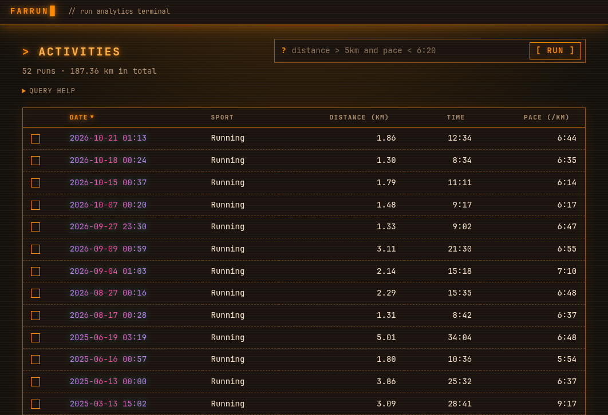
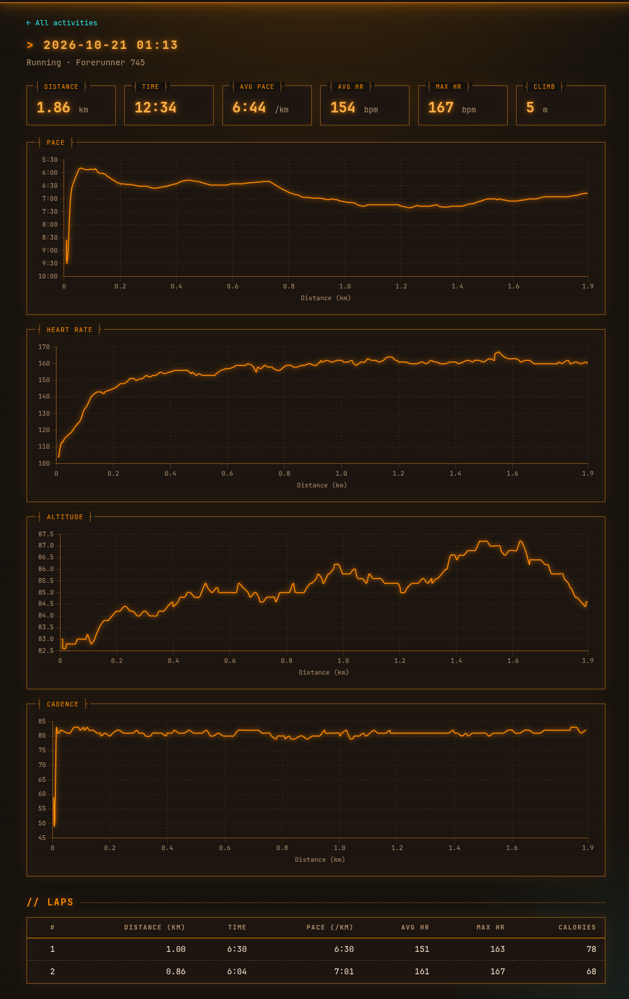
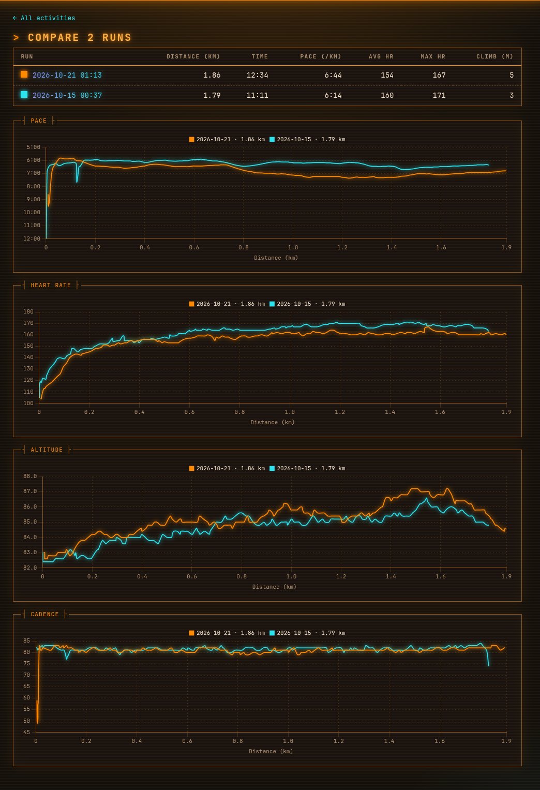

# FarRun

Track and analyze your runs from Garmin `.tcx` exports, in a local terminal-style web UI.

## Running it

Needs Go 1.27 or newer. Put your `.tcx` files in `activities/`, then:

    go run ./cmd/farrun import
    go run ./cmd/farrun serve

Open <http://127.0.0.1:8080>. No `.tcx` files? Use the demo data instead:

    go run ./cmd/farrun import --anon
    go run ./cmd/farrun serve --anon

## Runs list

Every run in a sortable table. Click a column header to sort, tick two or more runs and
compare them, or type a filter such as `distance > 5km and pace < 6:20`.

## Run details

One run in full: distance, time, pace, heart rate and elevation, a lap table, and pace,
heart rate, altitude and cadence charts over distance.

## Compare runs

Two or more runs side by side, with their charts overlaid on the same distance axis.

## Credits

Co-written with Claude Code. I focused on the backend and SQL; the AI agent worked on the
tests and the frontend.
